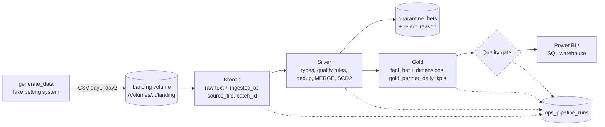

# Betting Data Lakehouse on Databricks


A small but complete data platform for sports bets, built with **PySpark and Delta Lake on Databricks** and organised as **bronze / silver / gold** (medallion architecture). It shows the full path from an operational source to an analytics-ready KPI table: incremental and idempotent loads, data quality with quarantine, SCD Type 2 history, a star schema, a run log, a quality gate, tests, CI and jobs defined as code.

The data is synthetic (fixed seed), shaped like a B2B sportsbook: 3 partners (betting operators), 300 customers, 40 football and tennis events, about 7,000 bets over two days, with realistic problems built in.

## Architecture



The pipeline runs as a **Databricks Job** with four dependent tasks: `bronze → silver → gold → quality`, parameterised by `batch_id`. The job is defined in `databricks.yml` (Databricks Asset Bundle).

## What each layer does

| Layer | Tables | Rules |
|---|---|---|
| Bronze | `bronze_partners`, `bronze_customers`, `bronze_events`, `bronze_bets` | Every column as text, exactly as delivered, plus `ingested_at`, `source_file`, `batch_id`. Re-loading a batch replaces that batch (`replaceWhere`), never duplicates it. |
| Silver | `silver_partners`, `silver_events` (SCD1), `silver_customers` (SCD2), `silver_bets`, `quarantine_bets` | Safe casts (`try_cast`), quality rules with a `reject_reason`, latest version per bet (`ROW_NUMBER`), `MERGE` on `bet_id` that updates only if the incoming row is newer. Customers keep history with `valid_from`, `valid_to`, `is_current`. |
| Gold | `dim_partner`, `dim_event`, `dim_customer`, `fact_bet`, `gold_partner_daily_kpis` | Star schema. Grain of `fact_bet`: one row per bet (latest version), joined to the customer version valid when the bet was placed. KPIs per day and partner: bets, active customers, turnover, settled turnover, payouts, GGR, margin. |
| Ops | `ops_pipeline_runs`, `ops_quality_results` | One log row per step per run; one row per quality check per run. |

### Quality rules (silver)

| Rule | `reject_reason` |
|---|---|
| `customer_id` missing | `missing_customer_id` |
| stake not a number or ≤ 0 | `invalid_stake` |
| odds not a number or < 1.01 | `invalid_odds` |
| `placed_at` / `updated_at` not a valid timestamp | `invalid_timestamp` |
| status not open / won / lost / void | `invalid_status` |
| `event_id` not in events | `unknown_event` |

### Quality gate (fails the job)

1. no duplicate `bet_id` in silver
2. no NULL keys in `fact_bet`
3. exactly one current row per customer
4. rejection rate of the batch ≤ 10 %
5. silver and gold bet counts match

### Metrics

- **Turnover** = sum of stakes
- **Payout** = stake × odds if won, 0 if lost, stake if void, unknown while open
- **GGR** (gross gaming revenue) = settled stakes − payouts
- **Margin** = GGR / settled stakes

## Results

Runs: day 1, day 2, then **day 2 again** to prove idempotency.

| | after day 1 | after day 2 | after day 2 again |
|---|---|---|---|
| Rows in bronze `bets` (cumulative) | 5,000 | 9,177 | 9,177 |
| Rejected to quarantine (cumulative) | 100 | 202 | 202 |
| `silver_bets` / `fact_bet` | 4,900 | 6,889 | 6,889 |
| Silver MERGE: inserted / updated | 4,900 / 0 | 1,989 / 1,888 | **0 / 0** |
| `silver_customers` rows (10 customers changed) | 300 | 310 | 310 |

The day-2 batch contains 2,000 new bets, 1,977 settlement updates for bets that were open on day 1, and 200 exact duplicates. The repeat of day 2 changed nothing: `DESCRIBE HISTORY silver_bets` shows a MERGE with 0 inserted and 0 updated rows.

**Reconciliation:** the final gold KPIs were recomputed independently in plain Python from the raw CSV files (same rules, no Spark) and matched to the cent.

`gold_partner_daily_kpis` after both days:

| bet_date | partner | bets | active customers | turnover | settled turnover | payouts | GGR | margin |
|---|---|---|---|---|---|---|---|---|
| 2026-10-26 | P-1 | 1,506 | 94 | 48,227.00 | 47,796.00 | 48,095.98 | −299.98 | −0.6 % |
| 2026-10-26 | P-2 | 1,728 | 102 | 53,300.00 | 52,857.00 | 56,153.45 | −3,296.45 | −6.2 % |
| 2026-10-26 | P-3 | 1,702 | 104 | 51,403.00 | 51,064.00 | 48,270.60 | 2,793.40 | 5.5 % |
| 2026-10-27 | P-1 | 598 | 94 | 16,971.00 | 11,221.00 | 10,389.52 | 831.48 | 7.4 % |
| 2026-10-27 | P-2 | 697 | 102 | 21,502.00 | 15,557.00 | 15,519.01 | 37.99 | 0.2 % |
| 2026-10-27 | P-3 | 658 | 104 | 20,507.00 | 13,415.00 | 11,473.56 | 1,941.44 | 14.5 % |

Total: turnover 211,910.00, settled 191,910.00, payouts 189,902.12, GGR 2,007.88 (margin 1.0 %). A single partner-day can be negative: with a few thousand bets, results swing with match outcomes even though the odds carry a margin of about 7 %. Day-1 bet counts grew from 4,900 to 4,936 after day 2 because some bets rejected on day 1 arrived again correctly as settlement updates on day 2.

## How to run

Requirements: a Databricks workspace (the Free Edition works) and the [Databricks CLI](https://docs.databricks.com/aws/en/dev-tools/cli/).

```bash
databricks auth login --host <your-workspace-url>
# once: create the schema and the landing volume
#   CREATE SCHEMA IF NOT EXISTS workspace.betting;
#   CREATE VOLUME IF NOT EXISTS workspace.betting.landing;
databricks bundle deploy
databricks bundle run betting_generate_data
databricks bundle run betting_pipeline --params batch_id=day1
databricks bundle run betting_pipeline --params batch_id=day2
```

Then open `06_demo` in the workspace (row counts, run log, history, time travel, SCD2, lineage, KPIs) or run `05_analysis` for the SQL questions in `sql/analysis.sql`.

Tests (local, needs Java 17):

```bash
pip install -r requirements-dev.txt
pytest -v
```

## Project layout

```
generate_data.py          fake source system (fixed seed), writes CSVs to the landing volume
01_bronze.py ... 04_quality.py   thin notebooks = the four job tasks
05_analysis.py, sql/analysis.sql business questions with window functions
06_demo.py                read-only demo of the results
betting_pipeline/         all logic as plain Python functions (testable)
tests/                    pytest with local Spark + Delta
databricks.yml            Asset Bundle: jobs as code
.github/workflows/ci.yml  runs the tests on every push
```

## Mapping to Azure and Microsoft Fabric

| In this project | On Azure Databricks | On Microsoft Fabric |
|---|---|---|
| Landing volume | ADLS Gen2 container, Auto Loader picks up new files | Lakehouse **Files** or a OneLake shortcut |
| Source extraction (here: generated CSVs) | CDC from the betting database via Data Factory (self-hosted integration runtime), Event Hubs for live bets | Data pipeline, mirroring, Eventstream |
| Delta tables in Unity Catalog | Same, with Unity Catalog on Azure | Lakehouse **Tables** (Delta in OneLake) |
| Databricks Job (4 tasks) | Same | Data pipeline running notebooks |
| Run log + quality gate | Job alerts, Lakeflow expectations, Log Analytics + action groups | Monitoring hub, alerts |
| Login via CLI OAuth | Managed identity, Key Vault, service principal for deployment | Workspace identity, Key Vault |
| pytest + GitHub Actions + Asset Bundle | Azure DevOps or GitHub Actions deploying the bundle per target (dev / test / prod) | Git integration + deployment pipelines |
| `gold_partner_daily_kpis` | SQL warehouse → Power BI | Power BI **Direct Lake**, row-level security per partner |

## What I would add in production

- **Incremental ingestion** with Auto Loader or CDC instead of named batch folders; streaming for live bets and liability.
- **Incremental gold** (recompute only the affected dates) instead of a full refresh.
- **CD**: deploy the bundle from CI to test and prod with a service principal, plus approvals.
- **Alerts** on job failure, freshness and volume anomalies; a runbook per alert.
- **Governance**: table owners and descriptions, masking of personal data in silver, row-level security per partner, GDPR erasure (DELETE + VACUUM + downstream copies) balanced with AML retention.
- **Performance** at scale: liquid clustering on `bet_date` / `partner_id`, OPTIMIZE, monitoring of skew on big events.
